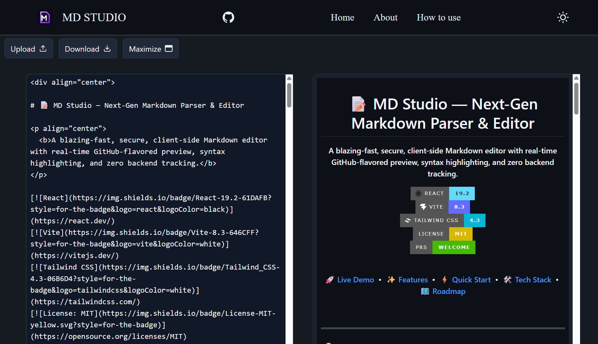

<div align="center">

# 📝 MD Studio — Next-Gen Markdown Parser & Editor

<p align="center">
  <b>A blazing-fast, secure, client-side Markdown editor with real-time GitHub-flavored preview, syntax highlighting, and zero backend tracking.</b>
</p>

[](https://react.dev/)
[](https://vitejs.dev/)
[](https://tailwindcss.com/)
[](https://opensource.org/licenses/MIT)
[](http://makeapullrequest.com)

<br />

[🚀 **Live Demo**](https://your-deployment-url.vercel.app) &nbsp;•&nbsp; 
[✨ **Features**](#-features) &nbsp;•&nbsp; 
[⚡ **Quick Start**](#-getting-started) &nbsp;•&nbsp; 
[🛠️ **Tech Stack**](#%EF%B8%8F-built-with) &nbsp;•&nbsp; 
[🗺️ **Roadmap**](#%EF%B8%8F-roadmap)

<br />

---

</div>

## 💡 Overview

**MD Studio** is a developer-focused, distraction-free Markdown editor and live preview tool. Built with modern web standards, it bridges the gap between raw Markdown code and GitHub-flavored visual output. 

Whether you're drafting technical documentation, taking AI/ML course notes, or writing README files for your open-source repositories, **MD Studio** gives you instantaneous visual feedback with rich syntax highlighting and complete privacy.

> [!NOTE]
> **100% Client-Side Privacy:** Your notes, snippets, and files never leave your browser. All parsing, file reading, and exports happen locally using browser FileReader and Blob APIs.

---

## ✨ Features

- ⚡ **Real-Time Live Preview**
  - Side-by-side editing: type Markdown on the left and watch rendered GitHub-flavored HTML update instantaneously on the right.
- 🎨 **Rich Syntax Highlighting**
  - Powered by **PrismJS** with the sleek **Okaidia** theme. Full syntax highlighting support for `JavaScript`, `JSX`, `Python`, `CSS`, `JSON`, `Markdown`, and more.
- 🛡️ **XSS Protection & Sanitization**
  - All rendered HTML passes through **DOMPurify** to ensure strict sanitization, preventing cross-site scripting (XSS) attacks.
- 🌓 **Dark & Light Mode**
  - Beautiful GitHub-inspired Dark (`#161b22`) and Light themes with persistent state saved in your browser's `localStorage`.
- 📂 **Import & Export (.md Files)**
  - **Upload:** Load any `.md` file straight from your computer into the editor with one click.
  - **Download:** Export your written Markdown document as an `.md` file instantly.
- 🖥️ **Focus / Fullscreen Mode**
  - Expand and collapse the workspace to eliminate distractions and focus purely on your writing.
- 📱 **Clean & Responsive UI**
  - Built with Tailwind CSS. Includes a responsive navigation drawer, clean toolbars, and smooth transitions on mobile, tablet, and desktop screens.

---

## 📸 Preview
<div align="center">

</div>
---

## 🔄 How It Works Under The Hood

MD Studio processes your text locally through a secure, high-speed rendering pipeline:

```text
┌──────────────────────┐
│  User Input / File   │  (Raw Markdown text via Editor or FileReader)
└──────────┬───────────┘
           │
           ▼
┌──────────────────────┐
│    marked.parse()    │  (Converts Markdown -> HTML tokens)
└──────────┬───────────┘
           │
           ▼
┌──────────────────────┐
│ marked-highlight     │  (Integrates PrismJS for code block syntax highlighting)
└──────────┬───────────┘
           │
           ▼
┌──────────────────────┐
│ DOMPurify.sanitize() │  (Strips dangerous scripts & attributes)
└──────────┬───────────┘
           │
           ▼
┌──────────────────────┐
│   Rendered Preview   │  (GitHub Markdown CSS styled presentation)
└──────────────────────┘
```

---

## 🛠️ Built With

| Technology | Purpose |
| :--- | :--- |
| **[React 19](https://react.dev/)** | Modern component-based user interface |
| **[Vite 8](https://vitejs.dev/)** | Ultra-fast next-generation frontend tooling |
| **[Tailwind CSS v4](https://tailwindcss.com/)** | Utility-first CSS styling and dark theme |
| **[Marked](https://marked.js.org/)** | High-performance GFM Markdown compiler |
| **[PrismJS](https://prismjs.com/)** | Lightweight, robust syntax highlighting engine |
| **[DOMPurify](https://github.com/cure53/DOMPurify)** | Trusted XSS sanitizer for generated HTML |
| **[React Router DOM](https://reactrouter.com/)** | Client-side page navigation (`/`, `/about`, `/how-to-use`) |
| **[React Icons](https://react-icons.github.io/react-icons/)** | Scalable vector icon library |

---

## ⚡ Getting Started

Follow these steps to run MD Studio locally on your computer.

### Prerequisites

- [Node.js](https://nodejs.org/) (version `18.0.0` or higher recommended)
- `npm` (bundled with Node.js) or `pnpm` / `yarn`

### Installation

1. **Clone the repository:**
   ```bash
   git clone https://github.com/YOUR_USERNAME/MD_Parser.git
   cd MD_Parser
   ```

2. **Navigate to the application folder:**
   ```bash
   cd Parser_project/my-app
   ```

3. **Install dependencies:**
   ```bash
   npm install
   ```

4. **Launch the development server:**
   ```bash
   npm run dev
   ```

5. **Open in browser:**
   Open [http://localhost:5173](http://localhost:5173) in your favorite browser.

---


## 📁 Project Structure

```plaintext
MD_Parser/
├── .gitignore
├── README.md                           # Repository documentation
└── Parser_project/
    └── my-app/
        ├── index.html                  # HTML entry point
        ├── package.json                # App dependencies & scripts
        ├── vite.config.js              # Vite & Tailwind configuration
        ├── components/
        │   ├── navbar.jsx              # Header with logo, links, & dark mode toggle
        │   ├── Hero.jsx                # Core dual-pane editor & preview container
        │   ├── toolbar.jsx             # File upload, download, & fullscreen controls
        │   ├── About.jsx               # Developer journey & project story
        │   ├── Htu.jsx                 # "How to Use" guide & feature breakdown
        │   └── footer.jsx              # Status indicator, branding, & social links
        └── src/
            ├── App.jsx                 # App routing & root state
            ├── App.css                 # Custom styling & scrollbar rules
            ├── index.css               # Global styling
            └── main.jsx                # React root mount point
```

---

## 🗺️ Roadmap

- [x] Real-time GitHub Flavored Markdown (GFM) parsing
- [x] Code block syntax highlighting with PrismJS
- [x] Client-side `.md` file import & export
- [x] Dual-mode dark/light theme with local persistence
- [x] Fullscreen / Focus mode
- [ ] 🤖 **Autonomous AI Agent:** Note summarization, code explanation, and auto-generated documentation in future development (soon)
- [ ] 📊 Word count, character count, and reading time metrics
- [ ] 📄 Export directly to PDF and styled HTML
- [ ] 🔄 Auto-save draft recovery using `localStorage`
- [ ] 🔗 Copy rendered HTML / Markdown to clipboard button

---

## 🤝 Contributing

Contributions make the open-source community an amazing place to learn, inspire, and create. Any contributions you make are **greatly appreciated**!

1. Fork the Project
2. Create your Feature Branch (`git checkout -b feature/AmazingFeature`)
3. Commit your Changes (`git commit -m 'Add some AmazingFeature'`)
4. Push to the Branch (`git push origin feature/AmazingFeature`)
5. Open a Pull Request

---
## 💬 Connect & Support

Created by **The Developer Omi Umar khan** 🚀

- **GitHub:** [@your-github-username](https://github.com/your-github-username)
- **LinkedIn:** [Your LinkedIn Profile](https://linkedin.com/in/your-profile)
- **Portfolio:** [yourportfolio.dev](https://yourportfolio.dev)

⭐️ If you found this project helpful, please give it a **Star** on GitHub!
